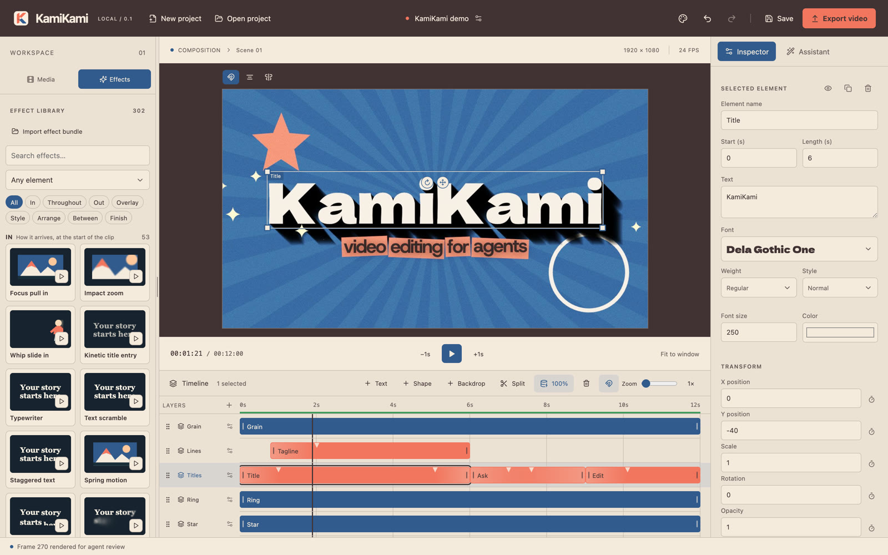

<p align="center">
  
</p>

<h1 align="center">KamiKami</h1>

<p align="center">
  <strong>An open source video editor designed for AI agents.</strong><br>
  Tell Claude Code, Codex or any MCP client what you want. It cuts, titles and animates your video on a real timeline, and you stay in control of every frame.
</p>

<p align="center">
  <a href="https://github.com/shawnzhesun/kamikami/releases/latest/download/KamiKami-mac-arm64.dmg"><strong>Download for macOS</strong></a>
  ·
  <a href="https://shawnzhesun.github.io/kamikami/">Website</a>
  ·
  <a href="#connect-your-agent">Connect your agent</a>
  ·
  <a href="docs/development.md">Build from source</a>
</p>



## Why KamiKami

Most video editors are built for hands on a mouse. KamiKami is built so an agent can do the work with you:

- **Agents use the same editor you do.** Every edit an agent makes lands on the open timeline, in the same undo history, while you watch. Nothing is generated in a black box.
- **Agents can see the result.** They render exact frames and timeline ranges, look at your media, and check their own work before telling you it's done.
- **Effects are data, not code.** Every effect is a declarative recipe, so agents can find, apply, tune and even author effects safely, and the preview matches the export frame for frame.
- **Local and private.** Your media and projects stay on your Mac. Nothing leaves it unless you connect an AI provider.

## Features

**Built for agents**
- A full MCP server: agents read the project, add and trim clips, place titles, apply and tweak effects, set keyframes, analyze media and export.
- Works with Claude Code, Codex, Claude Desktop and any other MCP client. KamiKami opens itself when an agent needs it.
- A built-in assistant tab for any OpenAI-compatible model, with the same tools.
- Revision checks on every edit, so an agent never overwrites changes it hasn't seen.
- Media analysis on request: shots, silences, loudness, tempo, and optional transcripts and descriptions that agents use to edit.

**A real editor**
- Multi-track timeline with snapping, ripple edits, split, trim, multi-select and deep zoom.
- Video, images, audio, text, vector shapes and animated backdrops.
- Keyframes on any property, with easing.
- Undo and redo for everything, including agent edits.
- A preview render cache: idle time is spent rendering the timeline with the export renderer, so playback matches the final video (marked green on the timeline).
- MP4 export with loudness normalization.

**A large effect library**
- Hundreds of built-in effects, organized by what they do: how an element arrives, moves, leaves, what's drawn around it, its surface, its layout, and the final grade.
- Kinetic typography, title animations, text looks, hand-drawn annotations, comic and broadcast overlays, film grain, light leaks and more.
- Hover any card to preview it; drag it onto a clip to apply it.
- Fork any effect into your own, and share effects as portable `.kamikami-effect.json` bundles.
- Built-in open-licensed fonts, plus your own.

## Install on macOS

KamiKami currently runs on **Apple Silicon Macs (M1 or later) with macOS 12 Monterey or later**.

1. Download **[KamiKami-mac-arm64.dmg](https://github.com/shawnzhesun/kamikami/releases/latest/download/KamiKami-mac-arm64.dmg)** from the [latest release](https://github.com/shawnzhesun/kamikami/releases/latest).
2. Open the DMG and drag **KamiKami** into **Applications**.
3. Open KamiKami from Applications.

> [!NOTE]
> Early releases aren't notarized by Apple yet, so macOS blocks the first launch with a message that it can't verify the app. To allow it:
>
> 1. Click **Done** (or **OK**) on the warning.
> 2. Open **System Settings → Privacy & Security** (on macOS 12: **System Preferences → Security & Privacy → General**) and click **Open Anyway** next to the KamiKami message.
> 3. Confirm with **Open Anyway** and your password.
>
> Or, in Terminal: `xattr -dr com.apple.quarantine /Applications/KamiKami.app`
>
> You only need to do this once.

Everything KamiKami needs is inside the app: no Node, Python or Homebrew. Projects and media are stored in `~/Library/Application Support/KamiKami`.

## Connect your agent

In KamiKami, open the **Assistant** tab, click the settings icon, and choose **Agent apps**. It shows the exact command for your install. For a standard install:

**Claude Code**

```sh
claude mcp add --transport stdio --scope user kamikami -- /Applications/KamiKami.app/Contents/Resources/bin/kamikami-mcp
```

**Codex**

```sh
codex mcp add kamikami -- /Applications/KamiKami.app/Contents/Resources/bin/kamikami-mcp
```

**Other MCP clients** (Claude Desktop, Cursor and others): add this to the client's MCP configuration.

```json
{
  "mcpServers": {
    "kamikami": {
      "command": "/Applications/KamiKami.app/Contents/Resources/bin/kamikami-mcp",
      "args": []
    }
  }
}
```

Then just ask:

> Import `~/Movies/trip` and the song `~/Music/summer.mp3`, cut the clips to the beat, and add a bold title at the start.

> Make the lyrics on the second track type on word by word, and give the whole video a warm film look.

> Render frame 120 and tell me if the title is readable over the background.

Deleting tools are marked as destructive, so your agent app asks before using them, and every edit can be undone from the editor.

### Built-in assistant

Prefer to stay in the app? Open **Assistant → Connect assistant** and enter any OpenAI-compatible endpoint, API key and model. Your key is encrypted with the macOS keychain and never reaches the editor or the conversation.

## Build from source

See [docs/development.md](docs/development.md). Coding agents should start with [AGENTS.md](AGENTS.md).

## Roadmap

- Windows and Linux builds.
- Signed and notarized macOS builds, and automatic updates.
- Style packs: downloadable effect bundles grouped by visual style.

See [docs/roadmap.md](docs/roadmap.md) for more.

## License

KamiKami is [MIT licensed](LICENSE).

The app bundles third-party software under its own licenses: [Remotion](https://www.remotion.dev/license) (free for individuals and small teams; larger companies need a Remotion company license), FFmpeg (an LGPL build for media analysis, and Remotion's [GPL build](https://www.remotion.dev/docs/miscellaneous/ffmpeg-license) for rendering), Chrome Headless Shell, and fonts under the SIL Open Font License (`public/fonts/LICENSES.txt`). The installed app includes their notices in `Contents/Resources/app/desktop-build/licenses`. See [docs/distribution.md](docs/distribution.md#ffmpeg).
